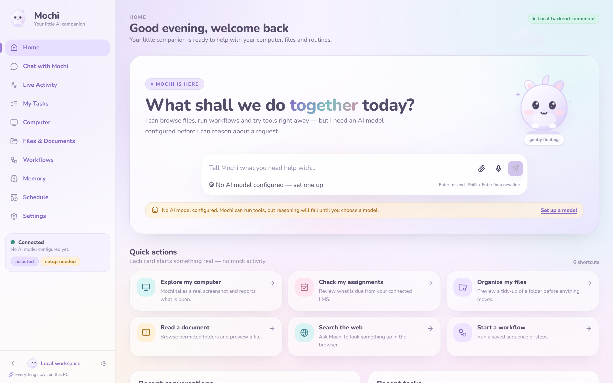
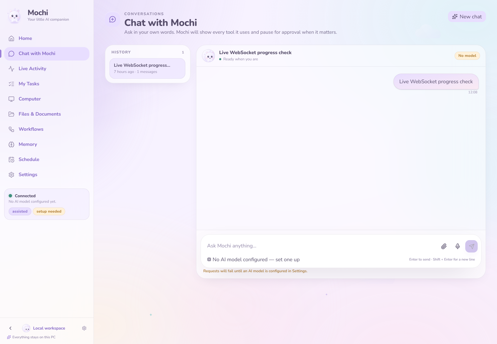
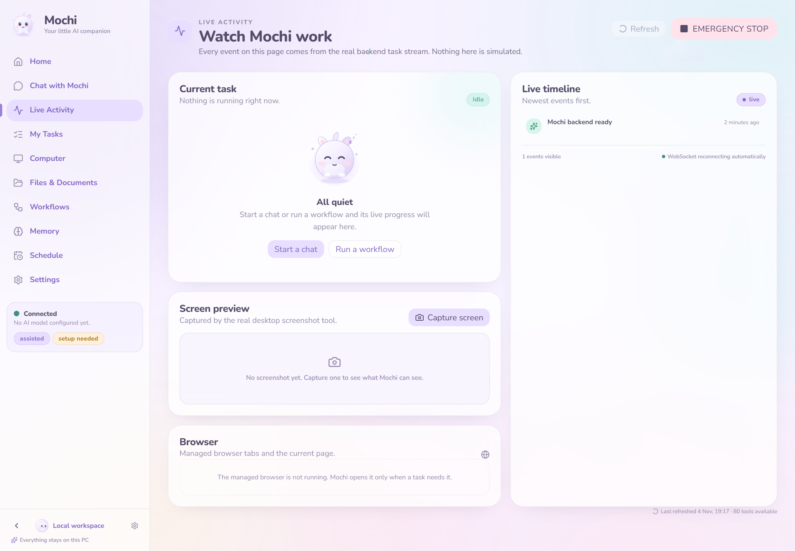
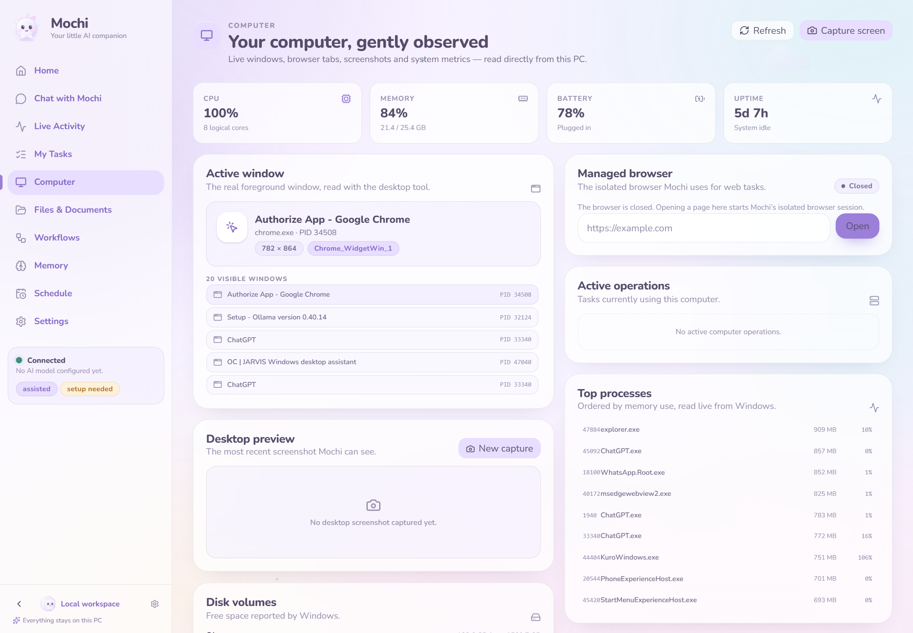
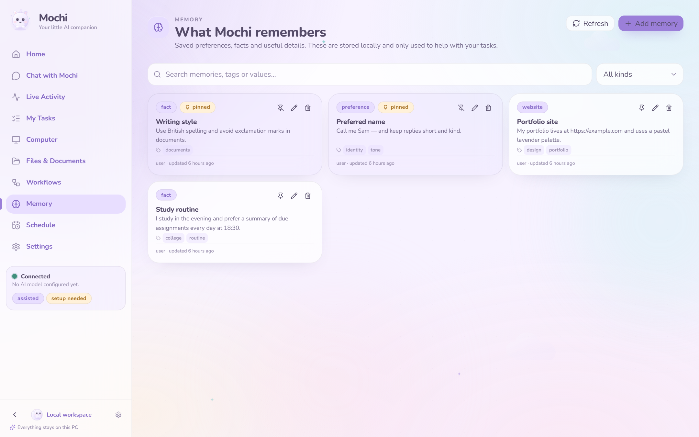

# Mochi — Your little AI companion

Mochi is a local-first AI desktop companion for Windows: a dreamy pastel interface
wrapped around a real autonomous agent. It is built with **Tauri 2**, **React 19**,
**TypeScript**, **Vite**, **Tailwind CSS 4**, **Zustand** and **Framer Motion**, and
talks directly to the existing **JARVIS FastAPI backend** on `127.0.0.1:8765`.

No mock responses. No simulated computer activity. Every visible control calls a
real backend route, and the backend remains the single source of truth.



## Highlights

- **Original mascot** with seven real states — idle, listening, thinking, working,
  success, error and sleeping — drawn as inline SVG/CSS. No emoji, no third-party
  character art.
- **Dreamy pastel design system** with light/dark themes, four accents, bundled
  Nunito / Nunito Sans fonts, glass surfaces and reduced-motion support.
- **Streaming chat** over WebSocket with Markdown, GFM tables, syntax-highlighted
  code, attachments, plan steps, real tool cards, stop and retry.
- **Real approvals** — the dialog shows the exact action, reason, target and
  consequences; Approve, Reject and Cancel all call the approval API, and
  dismissing never counts as approval.
- **Ten working screens** — Home, Chat, Live Activity, My Tasks, Computer, Files &
  Documents, Workflows, Memory, Schedule and Settings.
- **Live Windows telemetry** — CPU, memory, disks, battery, uptime, processes,
  foreground window and the visible window list.
- **Sandboxed files and documents**, persistent memory, workflow CRUD and
  schedules, all backed by the real service.
- **Safe desktop shell** — the window is localhost-only, capabilities are narrow,
  and the Rust process supervisor reuses a healthy backend or starts and cleans up
  only the child it owns.

| Chat | Live Activity |
|---|---|
|  |  |

| Computer | Memory |
|---|---|
|  |  |

The full set of 18 screenshots is in [`docs/screenshots/`](docs/screenshots/).

## Repository layout

```
apps/desktop/     Tauri 2 + React frontend and native Windows shell
backend/          JARVIS FastAPI service (FastAPI, SQLite, WebSocket)
docs/             Architecture, testing report, implementation report, screenshots
DEVELOPMENT.md    Build log and phase history
```

## Run it locally

Prerequisites: Node.js 20+ and pnpm 10+, Rust stable with the MSVC toolchain,
Python 3.11+ with the backend virtual environment, and WebView2.

```powershell
# 1. Backend
cd backend
.\.venv\Scripts\python.exe -m uvicorn app.main:app --host 127.0.0.1 --port 8765

# 2. Frontend (new terminal)
cd apps\desktop
pnpm install
pnpm dev            # browser at http://127.0.0.1:1420
pnpm tauri:dev      # or the native window
```

`pnpm tauri:dev` reuses an already healthy backend. Otherwise the Rust shell finds
`backend/app/main.py`, starts the venv Python, waits for `/api/health`, and stops
only the process it started when the window closes.

## Verify

```powershell
cd apps\desktop
pnpm typecheck      # strict TypeScript
pnpm test:run       # 52 frontend tests
pnpm build          # production frontend bundle
pnpm lint

cd ..\..\backend
.\.venv\Scripts\python.exe -m pytest    # 97 backend tests
```

## Package for Windows

```powershell
cd apps\desktop
$env:PATH = "$env:USERPROFILE\.cargo\bin;$env:PATH"
pnpm tauri:build    # NSIS installer under src-tauri/target/release/bundle/nsis/
```

See [`apps/desktop/README.md`](apps/desktop/README.md) for packaging details and
the current backend-bundling limitation.

## Documentation

- [`docs/MOCHI_IMPLEMENTATION_REPORT.md`](docs/MOCHI_IMPLEMENTATION_REPORT.md) —
  screens, API integrations, tests, screenshots and limitations
- [`docs/ARCHITECTURE.md`](docs/ARCHITECTURE.md) — backend architecture
- [`docs/BACKEND_TESTING_REPORT.md`](docs/BACKEND_TESTING_REPORT.md) — backend
  test results
- [`DEVELOPMENT.md`](DEVELOPMENT.md) — development log

## Current limitations

- A real LLM needs a configured provider. The default local provider is Ollama,
  and if it is not installed the UI says so instead of faking an answer.
- NVIDIA GPU/VRAM telemetry is not exposed by the backend.
- Optional extras (`faster-whisper`, `pyttsx3`, Tesseract, `yt-dlp`) degrade
  honestly when absent.
- The NSIS installer does not yet embed a frozen Python backend; shipping a fully
  self-contained build requires bundling a backend executable as a Tauri resource.
- No code signing or release installer has been produced yet.
